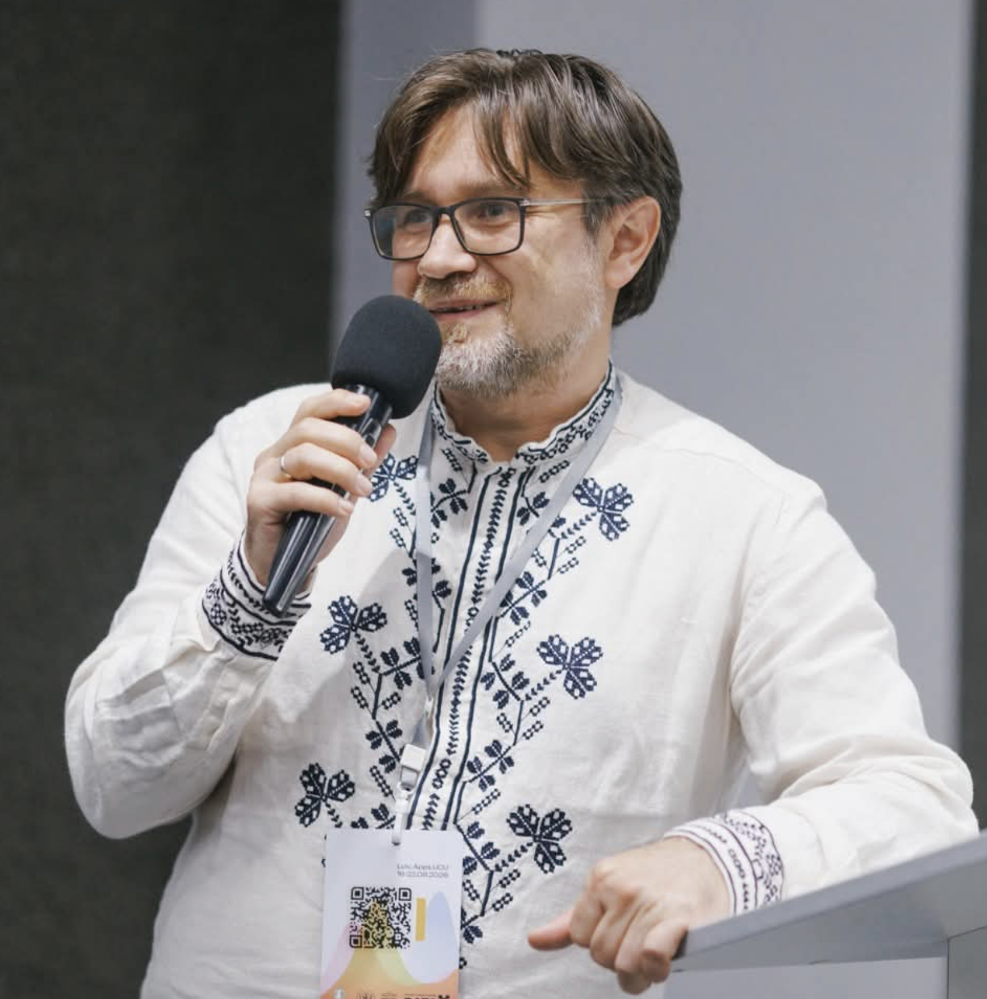

::: {.columns}

::: {.column width="30%"}
{fig-alt="Portrait of Oleksii Ignatenko" width=220}
:::

::: {.column width="70%"}
## Oleksii Ignatenko

My research and teaching interests include game theory,
formal verification, artificial intelligence, and mathematical
modeling.

This website documents my study and teaching of optimal control
and differential games. It combines mathematical exposition
with computational experiments and materials for students.

I am particularly interested in connecting rigorous strategy
guarantees with numerical evaluation and learning-based methods.
:::

:::

## About these notes

These are independently written lecture materials informed by
the books and papers listed on the [sources page](sources.qmd).

The aim is not to replace those references, but to provide a
coherent learning path supported by examples, visualizations,
and reproducible notebooks.

## Links

- [Course repository](https://github.com/ignatenko/Differential-games-lectures)
- [Course outline](course.qmd)
- [Computational notebooks](notebooks.qmd)